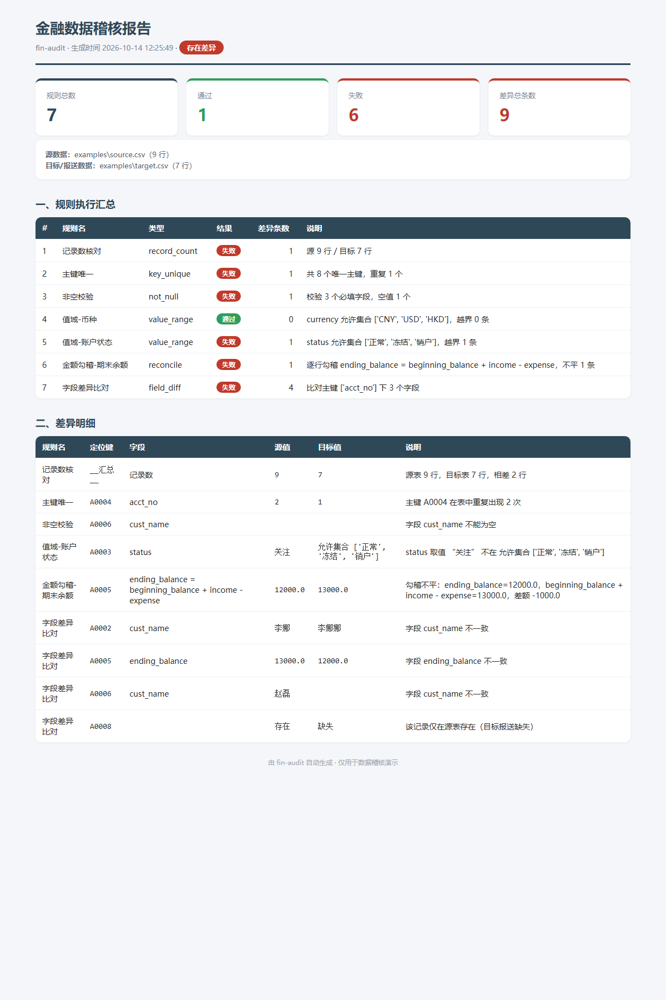

# fin-audit 演示说明

> 本目录是一次**真实运行**的产物，不是示意图。运行环境：Python 3.14 + pandas 3.0，
> Windows。所有数字都是下面这条命令实际跑出来的。

## 1. 这个项目是干什么的

`fin-audit` 是一个面向**金融数据治理 / 监管报送**场景的数据稽核 / 对账工具。
它按一份 JSON 规则，把「源数据」和「目标/报送数据」逐条比对，自动找出差异，
并输出一份 HTML 汇总报告 + 一份差异明细 CSV。

## 2. 解决了什么痛点

金融报送前要人工确认「源系统账务数据」和「报送出去的数据」一致，传统靠 Excel
VLOOKUP 人肉核对：**易漏、不可复现、不落痕**。本工具把核对**规则化**：写一次规则，
跑一条命令，几秒内列出「哪条规则没过、差几条、具体哪个账户哪个字段、源值多少、
目标值多少」，并生成可归档、可截图的报告。

## 3. 怎么运行

在项目根目录执行（示例数据与规则都随仓库提供）：

```bash
python -m fin_audit --config examples/example.json
```

## 4. 本次演示的实际结果

输入数据（`examples/`）：源表 `source.csv` **9 行**，目标表 `target.csv` **7 行**，
其中刻意埋入了：重复主键、行数不一致、字段被清洗错、状态值越界、金额勾稽不平、
以及一条只在源表存在的记录。

实际命令与结果：

```
python -m fin_audit --config examples/example.json

规则 7 条 · 通过 1 · 失败 6 · 差异合计 9 条
```

各规则命中情况（**实际命中条数**）：

| # | 规则名 | 类型 | 结果 | 差异条数 |
|---|--------|------|------|:---:|
| 1 | 记录数核对 | `record_count` | 失败 | 1 |
| 2 | 主键唯一 | `key_unique` | 失败 | 1 |
| 3 | 非空校验 | `not_null` | 失败 | 1 |
| 4 | 值域-币种 | `value_range` | **通过** | 0 |
| 5 | 值域-账户状态 | `value_range` | 失败 | 1 |
| 6 | 金额勾稽-期末余额 | `reconcile` | 失败 | 1 |
| 7 | 字段差异比对 | `field_diff` | 失败 | 4 |
|   | **合计** |  | 失败 6 / 通过 1 | **9** |

**总差异条数：9 条**（明细见 `diff_detail.csv`）。

命中的 9 条差异分别是：

1. **记录数**：源 9 行 / 目标 7 行，差 2 行；
2. **主键唯一**：`A0004` 在源表重复出现 2 次；
3. **非空**：目标表 `A0006` 的 `cust_name` 为空；
4. **值域-状态**：目标表 `A0003` 的 `status = "关注"` 不在允许集合 `[正常, 冻结, 销户]`；
5. **金额勾稽**：目标表 `A0005` `ending_balance=12000`，但 `beginning+income−expense=13000`，差 −1000；
6. **字段差异**：`A0002` 的 `cust_name`（李娜 → 李娜娜）、`A0005` 的 `ending_balance`（13000 → 12000）、
   `A0006` 的 `cust_name`（赵磊 → 空）；
7. **字段差异（记录级）**：`A0008` 仅在源表存在，目标报送缺失。

## 5. 演示产物

| 文件 | 说明 |
|------|------|
| `report.html` | HTML 汇总报告（浏览器打开即为完整报告） |
| `report.png` | 报告截图（无头 Chrome 生成，可直接贴到文档/讲解里） |
| `diff_detail.csv` | 9 条差异的明细（规则名 / 定位键 / 字段 / 源值 / 目标值 / 说明） |



## 6. 复现测试

```bash
python -m pytest -q      # 12 passed
```
